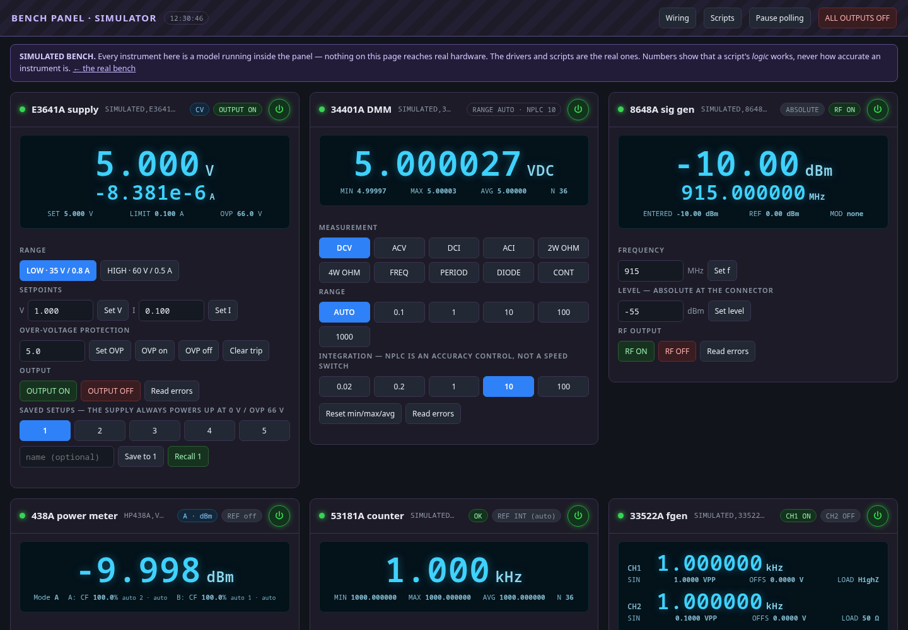
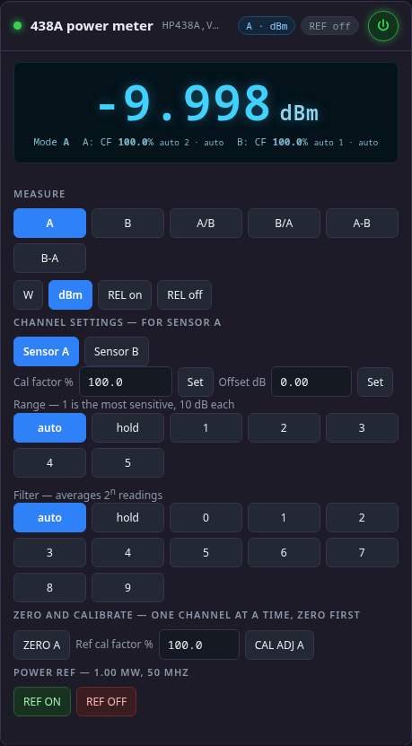
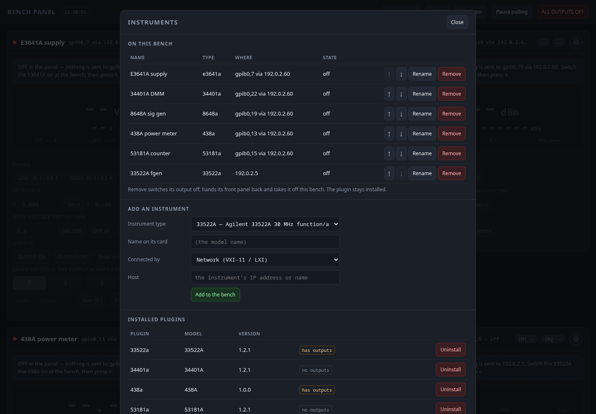
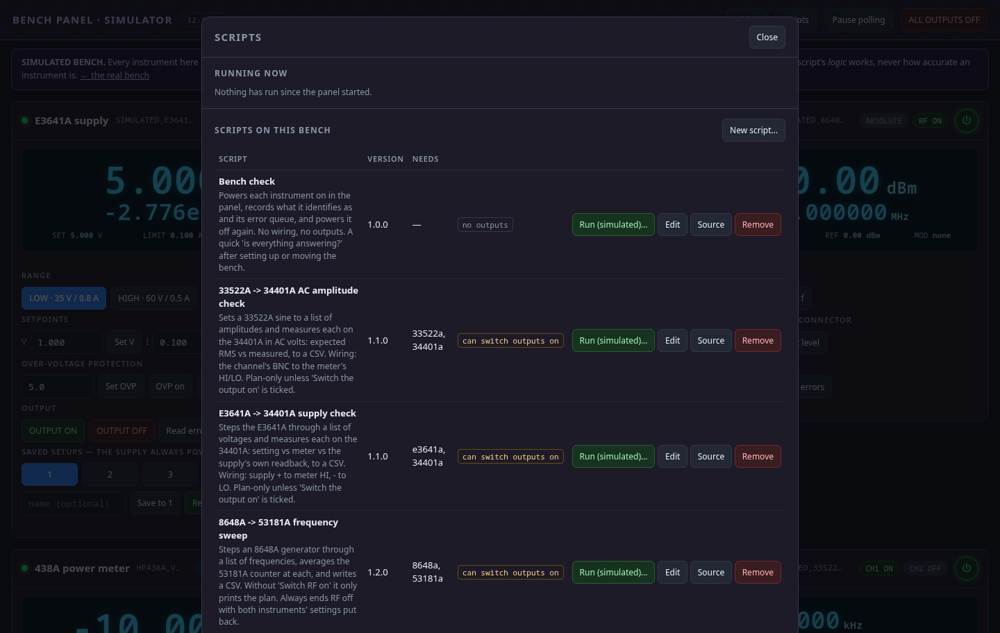
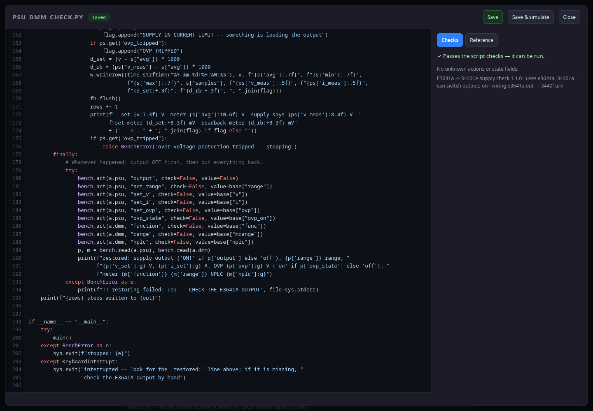
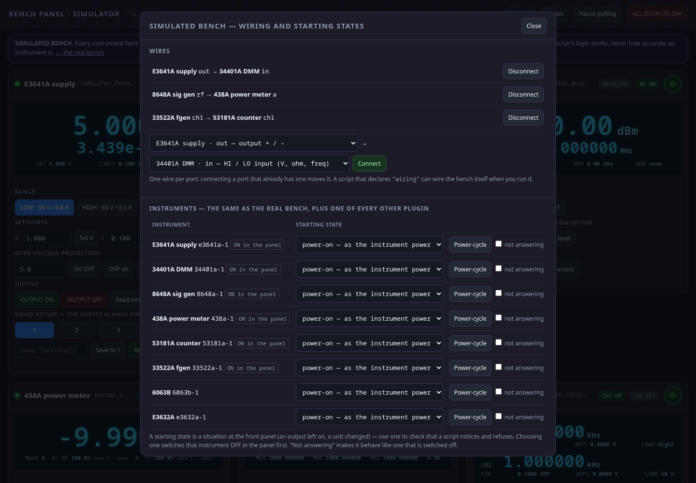
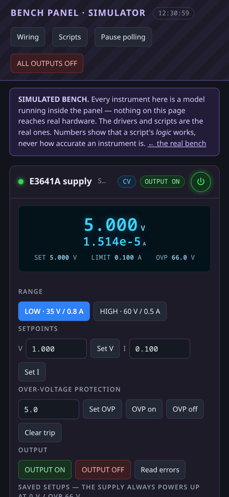

# Bench Panel

A live control panel for bench test instruments, in your browser. One card per
instrument with a big readout and real controls, plus a log of every SCPI command and
reply.

- **Stand-alone.** One Python program is the whole thing, and it serves its own page.
  You don't need a web server. Run it, and your browser opens.
- **Plug-in instruments.** The program ships with **no instruments built in**. Each one is
  a plugin, loaded through the same interface anyone writing a new one would use. The
  dashboard starts empty. You install plugins and add instruments from the page itself,
  with no restart.
- **Your bench stays out of the code.** Which instruments you have and where they are
  (GPIB addresses, IP addresses) live in `site.json`, which is never committed.

Eight plugins come in the `catalog/` folder: Keysight **E3641A** and Agilent **E3632A**
supplies, HP **6063B** electronic load, HP **34401A** meter, HP **8648A** signal generator, Agilent **33522A** function
generator, HP **53181A** frequency counter and HP **438A** power meter (which predates SCPI:
see `identify` in PLUGIN_STANDARD.md).

- **Scriptable.** Anything the page can do, a script can do under the same safety
  rules: see **[API.md](API.md)**, the one-file Python client `client/benchpanel.py`,
  and a worked sweep in `examples/`.
- **One standard for every plugin.** [PLUGIN_STANDARD.md](PLUGIN_STANDARD.md) is the
  contract, and `tools/check_plugin.py` enforces it. The program runs the same checks
  when it installs or loads a plugin, and refuses one that fails. The safety rules are
  tested by trying to break them.



*Every screenshot here is the built-in simulator, or a placeholder bench on the
192.0.2.x documentation addresses. The drivers are the real ones; the numbers are
models. More below, under [Screenshots](#screenshots).*

---

## Why we built it

The bench this grew out of is a garage full of classic HP and Agilent instruments: an
E3641A supply, a 34401A meter, an 8648A signal generator, a 53181A counter, a 438A
power meter. Most of them talk GPIB through one ICS 8065 LAN-to-GPIB gateway, and they
are driven from a Linux workstation. In September 2026 we went looking for a program
to run that bench, and found a gap:

- Keysight BenchVue, the obvious answer, runs only on Windows. There's no Linux
  equivalent.
- `lxi-gui` can ask a VXI-11 gateway only for the device `inst0`. The 8065 wants
  `gpib0,22`, and refuses `inst0`.
- Node-RED has no GPIB or SCPI nodes, and every Deploy tears connections down and
  rebuilds them. That churn is exactly what had already wedged the 8065 four times.
- The screen Ernesto liked best, a 34401A control and datalogging app, was Windows
  and serial only. It was a picture of what he wanted, not something he could run.

So we wrote a plan, and on 22 September 2026 a first panel: one page, a supply and a
meter. It drove the real bench that day. Then Ernesto asked the question that shaped
everything since: *is it plug-and-play?* The honest answer was no. His own plan said
the core should ship with no instruments, and the first version had all four
special-cased. The next day it was rebuilt that way. Every instrument is a plugin,
including the first. Every plugin meets one written standard, which the program
checks by trying to break its safety rules. And because, in Ernesto's words, "not
everyone has a webserver running on their PC", the whole thing is one stand-alone
program.

The bench has been the test ever since. The first plugin written to the standard,
for the 53181A, found a real fault on its first frequency sweep: the counter's
channel 1 goes deaf above about 120 MHz, and it reports wrong numbers with no error
while it does. Scripts, a simulator and a script editor followed, then plugins for
the E3632A, the 6063B load and, most recently, the 438A, which is old enough to
predate SCPI.

---

## Install

Needs Python 3.10 or newer. Pick one.

**Installed (recommended).** Gives you a `benchpanel` command and a menu launcher:

```
pipx install /path/to/bench-panel            # or: pipx install benchpanel-1.0.0-py3-none-any.whl
benchpanel --install-launcher                # adds BenchPanel to the desktop app menu
benchpanel                                   # or click the launcher
```

No `pipx`? A virtual environment does the same:

```
python3 -m venv ~/.local/opt/benchpanel
~/.local/opt/benchpanel/bin/pip install /path/to/bench-panel
ln -s ~/.local/opt/benchpanel/bin/benchpanel ~/.local/bin/benchpanel
```

Extras for other instrument connections: `pipx install "/path/to/bench-panel[usb]"` (USB-TMC)
or `[gpib]` (a local GPIB card through linux-gpib).

**Portable, no install.** Run it straight from this folder:

```
pip install -r requirements.txt
python3 bench_panel.py
```

### Where your bench is kept

| Run as | `site.json`, installed `plugins/`, imported `scripts/` and `results/` live in |
|---|---|
| `benchpanel` (installed) | Linux `~/.local/share/benchpanel`, Windows `%APPDATA%\BenchPanel`, macOS `~/Library/Application Support/BenchPanel` |
| `python3 bench_panel.py` | this folder, next to `bench_panel.py` (how the example service in `deploy/` runs it) |
| either, with `--data-dir DIR` or `BENCHPANEL_DATA=DIR` | `DIR` |

Upgrading the program never touches that folder. New catalog versions show in the
Instruments manager as **Update x → y**.

### The launcher

`benchpanel --install-launcher` adds a menu entry that opens a terminal window running
BenchPanel, plus your browser on it. **Closing that window stops BenchPanel safely**,
the same as Ctrl-C: outputs off, front panels handed back. Clicking the launcher
again while it's running just opens the browser on the running one.
`--uninstall-launcher` removes it.

- **Linux:** a standard `.desktop` entry and icon in `~/.local/share`, checked with
  `desktop-file-validate`. GNOME may only list a new entry after you log out and back in.
- **Windows:** a Start-menu shortcut. **Not yet tested on a Windows machine.**
- **macOS:** no launcher yet; run `benchpanel` from Terminal.

## Quick start

Start it (`benchpanel`, the launcher, or `python3 bench_panel.py`), and your browser opens
on `http://127.0.0.1:8765`.

1. The page says **No instruments on this bench yet**. Click **Add an instrument**.
2. Under **Get plugins**, click **Install** beside your instrument. You see what it is
   first, and only then confirm.
3. Under **Add an instrument**, pick it, choose how it's connected, fill in the address
   and click **Add to the bench**. Its card appears, **OFF**.
4. Switch the instrument on **at the bench**, then press the card's **⏻**.

**No hardware yet?** Click **Simulator**: the same dashboard on a simulated bench,
with a model of every installed instrument (see [SCRIPTS.md](SCRIPTS.md#the-simulator)).
For a bare pretend socket instead, add it as *Other VISA resource*:

```
python3 tools/sim_scpi.py --model 34401A --port 5025
#   resource:  TCPIP0::127.0.0.1::5025::SOCKET
```

The simulator answers `*IDN?` with the model you give it and remembers what you set.
That's enough to try the dashboard. It proves nothing about a driver's commands.

### Options

```
benchpanel --port 9000              # another port
benchpanel --no-browser             # don't open a browser (for a service)
benchpanel --data-dir /path/dir     # keep site.json, plugins/, scripts/ and results/ somewhere else
benchpanel --no-poll                # start with polling paused
benchpanel --host 0.0.0.0 --auth-file ~/.bench_login
```

It listens on **127.0.0.1 only** unless you give it a login. See [Safety](#safety).

---

## Using it

1. Switch on, **at the bench**, the instruments you want.
2. Open the panel. Every card starts **OFF**: dimmed, controls locked, and nothing is
   sent to that instrument.
3. Press the card's **⏻** (the IEC 60417-5009 standby symbol). The panel connects and
   asks `*IDN?`. Only if the answer names the right model does it send anything else
   and start polling. The button turns green.
4. Work.
5. Press **⏻** again when done. Any output is switched **off**, the front panel is
   handed back, and that one connection is closed.

⏻ switches an instrument on and off **in the panel only**. It never touches the
instrument's own power switch, and turning a card ON never enables an output.

| Awkward case | What the panel does |
|---|---|
| Instrument not switched on at the bench | "Not answering at … — is it switched on?" within about 2–4 s. It stays OFF and isn't retried |
| The gateway **refuses the connection** (it can be briefly busy just after releasing links) | Retried 3 times, 2 s apart, without holding up the other instruments. If it still refuses, the card says the gateway is busy or wedged, not that the instrument is off |
| A different instrument answers at that address | Refused. **Nothing** is sent to it, and the IDN it gave is shown |
| Switched off at the bench while ON in the panel | One reconnect is tried, then the card goes OFF with a red note. If the instrument has an output, the note says the output could **not** be switched off from here |
| Any control pressed while the card is OFF | Refused by the server: "press its power button first" |
| **ALL OUTPUTS OFF** (header) | Acts on every instrument that is ON. It lists any output it could not confirm off |
| An instrument's plugin is missing or broken | Its card stays, with the reason, and no power button, so it can't vanish silently |

---

## The Instruments manager

The **Instruments** button in the header opens it. It has four sections.

**On this bench:** every instrument in `site.json`, in card order, with ↑ ↓ to
reorder, **Rename**, and **Remove** (two clicks). Remove switches the output off, hands
the front panel back and takes the instrument off the bench. Its plugin stays
installed.

**Add an instrument:** pick an installed plugin and a name, then how it's connected:

| Connected by | You give | Example |
|---|---|---|
| GPIB, through a LAN gateway | gateway host + GPIB address 0–30 | ICS 8065, any VXI-11 LAN/GPIB box |
| Network (VXI-11 / LXI) | the instrument's host | a LAN instrument that speaks VXI-11 itself |
| Other VISA resource | a VISA resource string | `USB0::0x0957::0x2C07::MY123::INSTR`, `TCPIP0::10.0.0.9::5025::SOCKET`, `ASRL/dev/ttyUSB0::INSTR` |

A plugin lists the connection types it supports, and only those are offered. The same
address can't be added twice.

**Installed plugins:** with version and whether it has outputs. **Uninstall** is
refused while any instrument on the bench uses that plugin. An uninstalled or replaced
plugin is kept as `plugins/.old-<id>-<time>`, so it can be undone.

**Get plugins:** plugins can come from two places, and nowhere else:

- **the catalog:** the `catalog/` folder that comes with this program. `git pull`
  brings new ones and updates; a newer version shows as **Update x → y**.
- **a .zip you choose** from your own computer.

A plugin is Python that runs on this computer with your instruments in reach. It can
switch on a power supply. So nothing installs until you have seen its name, version,
whether it has outputs, the connections it supports, what it was tested on, its known
quirks, its file list and its SHA-256, and then confirmed. An upload is held in memory
between the two steps, so what installs is byte for byte what you saw. **There is no
install from a web link.**

A zip is refused if it has nested folders, paths that escape the plugin folder, or file
types a plugin doesn't ship (it allows `.py .json .html .js .css .svg .md .txt .png`),
or if it's over 5 MB. An upgrade is refused while any instrument using the plugin is
ON.

---

## Scripts

The **Scripts** button imports, lists and runs automation scripts. A script is a
`.py` file with a short `BENCHPANEL_SCRIPT` header naming what it needs, whether it
can switch outputs on, and its settings. The Run form is built from that header.

- **Import** from the program's catalog (`examples/`) or a `.py` you choose. You see
  the whole source and the check result before anything is written. There's no
  import from a link.
- **Run** one at a time, with a live log. A script that can switch outputs on needs
  **"Allow this run to switch outputs on"** ticked and a second click. Unticked, the
  panel refuses its output-on commands, which makes a safe dry run.
- **Stop** sends Ctrl-C so the script restores the bench. If a script that can switch
  outputs on doesn't end cleanly, the panel presses ALL OUTPUTS OFF itself.
- A script can't use the Instruments or Scripts managers.

- **Download** what a script wrote: each run lists its files, and a **Results** section
  lists the whole results folder.
- **Four scripts ship in the catalog:** a bench check (no outputs), E3641A → 34401A
  supply check, 33522A → 34401A AC amplitude check, and the 8648A → 53181A sweep.
- **Edit** a script, or start a **New script…** from a template, in the built-in editor.
  Its reference, completion and lint come from each instrument's own dictionary in its
  manifest.
- **Simulator** (`<panel>/sim/`): the same dashboard on a simulated copy of the bench.
  The real drivers talk to per-plugin instrument models, with virtual wiring between
  them. Try a script, and its refusals, with no hardware in reach.

How to write one: **[SCRIPTS.md](SCRIPTS.md)**. What changed, version by version:
**[CHANGELOG.md](CHANGELOG.md)**. Check one first with
`python3 tools/check_script.py my_script.py`.

---

## The site config — `site.json`

Everything specific to your bench, and nothing else. The Instruments manager writes it.
You rarely need to edit it by hand, but you can (with the program stopped).
`site.example.json` shows the shape:

```json
{
  "schema": 1,
  "defaults": {"gateway": "192.0.2.60"},
  "instruments": [
    {"id": "34401a-1", "plugin": "34401a", "name": "Bench DMM",
     "connection": {"type": "gpib-gateway", "gateway": "192.0.2.60", "address": 22}},
    {"id": "33522a-1", "plugin": "33522a", "name": "33522A",
     "connection": {"type": "vxi11", "host": "192.0.2.5"}}
  ]
}
```

Every write is atomic (temporary file + rename) and keeps the previous file as
`site.json.bak`. A missing `site.json` is simply an empty bench. It's in `.gitignore`,
along with `plugins/`, because addresses and your inventory don't belong in git
history.

---

## Safety

Three of the four catalog instruments can source power or signal, so:

- **Nothing is contacted until its ⏻ is pressed**, and `*IDN?` must name the right model
  before any other command is sent.
- **Enabling any output needs an explicit `confirmed` flag.** The server refuses without
  it, so no stray or replayed request can switch anything on. In the page it takes two
  deliberate clicks, and the arm expires after 4 s. Recalling a saved setup that can
  change an output is treated the same way.
- **ALL OUTPUTS OFF** is always one click away and needs no confirmation.
- **⏻ OFF, Remove, Ctrl-C, SIGTERM and normal exit all leave the bench safe:** outputs
  off, then the front panel handed back, for every instrument that is ON. The console
  says which outputs were **confirmed** off, not just attempted. A service restart
  therefore switches off the outputs of every card that was ON. That's deliberate, but
  know it before it surprises you mid-measurement.
- **`has_output` is declared in the plugin's manifest**, and the core's safety rules key
  off it without knowing the model. A driver that disagrees with its own manifest, or
  that declares outputs without an `all_off()`, is refused at load.

And because a web page can press these buttons:

- **It listens on 127.0.0.1 only** unless you give it `--auth-file`, a file holding one
  line `user:password` (8+ character password, `chmod 600`, or it refuses to start).
  That turns on a built-in login, for the day you want to reach it from another
  machine without a proxy. It is plain HTTP, so on anything but a trusted LAN, put TLS
  in front (see `deploy/`).
- **Every POST must carry an `X-Bench-Panel: 1` header.** A page on another site can't
  add one without the browser asking this server first, and this server never agrees.
  So a web page you happen to visit can't switch your supply on through
  `127.0.0.1:8765`.
- **On loopback it checks the `Host` header**, so a hostile DNS name pointed at
  127.0.0.1 is refused (DNS rebinding).
- **A plugin's `driver.py` is never served to the browser.** Only the two card files the
  manifest names are served.

---

## How it's built

```
browser  ─ GET  /                      static/index.html + app.js + style.css
         ─ GET  api/state              every card's state + the traffic log
         ─ GET  plugin/<id>/card.*     the card's html + js (only those two files)
         ─ POST api/action             {instrument, action, args}  one card's control
         ─ POST api/manage             {op, ...}  plugins and the bench
         ─ POST api/scripts            {op, ...}  import, list, run and stop scripts
bench_panel.py      portable launcher: runs benchcore.server with data next to itself
pyproject.toml      the package: `benchpanel` command, benchcore + static + catalog + client
benchcore/
  server.py         HTTP server, the manager ops, security checks, safe shutdown, data folder
  launcher.py       desktop menu entry (Linux .desktop; Windows shortcut, untested)
  transport.py      Link: the ONLY code that moves bytes (VXI-11 gateway, VXI-11, VISA)
  instrument.py     the Instrument base class every driver subclasses; the power button
  plugins.py        find, check, load, install and uninstall plugins
  bench.py          site.json, the instruments on the bench, the poll loop
  scripts.py        automation scripts: header checks, import, the one-at-a-time runner
catalog/<id>/       plugins that ship with the program (manifest, driver, card, README)
plugins/<id>/       plugins installed on THIS machine (not in git)
static/             the page: index.html, app.js (knows no instrument), style.css
tools/sim_scpi.py   a pretend instrument for trying it without hardware
tools/check_plugin.py  the plugin standard checker (deploy.sh runs it on catalog/)
tools/gen_api_actions.py  generates API_ACTIONS.md from the manifests
client/benchpanel.py  Python client for scripts (stdlib only; see API.md)
examples/           the script catalog: scripts the Scripts window can import
scripts/            scripts imported on THIS machine (not in git); results/ what they wrote
tools/check_script.py  the same checks as the Scripts window's import screen
tests/test_scripts.py  proves those checks, the import flow and Stop/cleanup work
tests/test_conformance.py  proves the checker catches each rule it claims to
  conformance.py    the plugin standard as code (PLUGIN_STANDARD.md is the prose)
deploy/             an example server deployment: systemd unit, Apache proxy + login, deploy.sh
local/              YOUR site's deploy settings (not in git): see deploy/README.md
```

**Transports belong to the core, never to a plugin** (plan §3.6). A driver calls
`self.link.query()` and `self.link.write()` and never learns which path it's on. So
moving an instrument from a GPIB gateway to LAN is a change to `site.json` and nothing
else.

| | GPIB via gateway | VXI-11 (LAN) | Other VISA |
|---|---|---|---|
| VISA resource | `TCPIP0::<gw>::gpib0,<n>::INSTR` | `TCPIP0::<host>::inst0::INSTR` | as given |
| lock | one per gateway, because it's one bus | its own | its own |
| REN | asserted on every connect | n/a | n/a |
| front panel back | VXI-11 `device_local` | VXI-11 `device_local` | GTL if the path has one, and it says so if not |

**No dependencies beyond `pyvisa` + `pyvisa-py`**, and no web framework. It's one page
and three JSON endpoints. That's fewer moving parts for something that has to keep
working on a bench machine for years.

Writing a plugin: see **[PLUGINS.md](PLUGINS.md)**. The rules it must meet:
**[PLUGIN_STANDARD.md](PLUGIN_STANDARD.md)**. Writing one with Claude Code or Claude.ai:
**[PLUGINS_WITH_CLAUDE.md](PLUGINS_WITH_CLAUDE.md)**. The repo's `CLAUDE.md` gives Claude Code the same rules automatically.

**The core enforces each plugin's declarations itself.** An action the manifest
doesn't declare never reaches the driver. An action declared as needing confirmation
is refused without it, before the driver runs. That's a second lock, independent of
the driver's own check.

---

## Things the bench taught us, encoded in the core

- **The ICS 8065 drops an idle link at about 120 s** (105 s was fine, 125 s gave
  `ConnectionReset`). `Link` keeps a 30 s `*OPC?` keepalive and rebuilds itself once
  on a failed exchange. Pausing polling doesn't stop the keepalive, and that's exactly
  when it's needed.
- **`create_link` proves nothing.** It's local to the gateway and succeeds with the bus
  empty. `*IDN?` is the first call that reaches the device.
- **Release is `device_local`, never `SYST:LOC`.** Over GPIB, `SYST:LOC` queues
  `+514 "Command allowed only with RS-232"` on the E3641A and the 34401A, and pyvisa's
  `control_ren(address_gtl)` raises against the 8065.
- **REN is bus-wide.** Dropping it puts *every* GPIB instrument into local. The core
  asserts REN on every gateway connect, so it recovers from any script that ended by
  dropping it. It never drops REN itself, not even on ⏻ OFF.
- **pyvisa's ResourceManager is a shared singleton**, and its `close()` ends everyone's
  sessions. There is one manager, never closed, and a link closes only its own
  resource. Before this fix, switching one instrument off killed the others
  (`InvalidSession`).
- **One bus, one lock.** A ⏻ press overlapping the poller's `READ?` once froze the whole
  panel. Links through the same gateway share a lock. A **watchdog** shuts a link's
  socket if any exchange runs 8 s past its timeout, which turns a hang into an error
  the retry logic handles. (The watchdog hasn't yet been seen firing on the real bench.)
- **Absent instruments cost time on every pass**, which is why everything starts OFF.
  The connect-time `*IDN?` has a 2 s timeout (real instruments answer in under 0.2 s).

---

## Running it as a service

`deploy/` is a worked example (see `deploy/README.md`): a server runs it under systemd on 127.0.0.1,
with Apache in front for TLS and a login.

```
sudo systemctl status  bench-panel      # is it up?
sudo systemctl restart bench-panel      # safe shutdown first; comes back with every card OFF
sudo journalctl -u bench-panel -n 50    # its startup summary lists plugins, broken ones and the bench
```

From the development machine:

```
./deploy/deploy.sh          # rsync code + catalog, restart, show status
./deploy/deploy.sh --docs   # also publish local/bench_docs.html
./deploy/deploy.sh --unit   # also install deploy/bench-panel.service
```

`deploy.sh` never touches the server's `site.json` or `plugins/`. Those are the live
bench. New catalog versions arrive with a deploy and are installed from the dashboard
(**Update x → y**).

If the proxy passes the browser's own `Host` header through (`ProxyPreserveHost On`),
the loopback Host check will refuse it. Leave it off, which is Apache's default.

---

## Not done yet

- Save/recall registers on the **8648A** card (300 registers, 10 sequences)
- More plugins: 8920A (never send it `RFAN:TMOD 'MANUAL'`: it hangs)
- Serial instruments need remote/local by SCPI (`SYST:REM`) rather than by bus
  operation. The transport has the facet flags for it, but no driver uses them yet
- Buffered high-speed acquisition on the 34401A (`TRIG:COUN` / `INIT` / `FETCH?`)
- Data logger, graphs, CSV export (scripts can write CSVs; the dashboard has no viewer for them)
- Scripts on a schedule, or several at once
- SVG faceplates and Tier-1 declarative (no-code) plugins, from the plan. Today every
  plugin is a Tier-2 code plugin
- Transaction traces replayed in CI
- One shared login at most; no per-user accounts or audit trail

## Before this repository is ever made public

Published from a fresh history: site addresses, the deploy host and the site's own
docs page live in `local/`, which git ignores.

## Screenshots

| | |
|---|---|
|  | **HP 438A power meter card.** Reading in dBm off the simulated 8648A, per-channel cal factor, offset, range and filter, ZERO and CAL ADJ (two clicks each), and the POWER REF output. |
|  | **Instruments manager.** What's on this bench and where, adding an instrument, and the installed plugins. Placeholder addresses. |
|  | **Scripts window.** Each script declares what it uses and whether it can switch an output on; the ones that can need an extra tick to run. |
|  | **Script editor.** Checks against the plugins' own dictionaries, and a reference pane. Shown: the `finally:` that puts the bench back however the run ends. |
|  | **Simulator wiring.** Virtual cables between outputs and inputs, and starting states that copy real front-panel situations. |
|  | **On a phone.** The same page, one card wide. |

## Credits

- **Ernesto Castoza:** the bench and its instruments, the plan, the requirements that
  mattered most (plug-and-play for real, stand-alone, one standard for every plugin),
  and every test on real hardware. Also the person at the bench when the numbers came
  back wrong.
- **Claude** (Anthropic's AI model, working in Claude Code): the design and the code,
  written as Ernesto's pair programmer. Every instrument command is taken from that
  instrument's manual, with the page cited, and checked on the real bench before a
  plugin is marked tested.

## License

MIT. See [LICENSE](LICENSE). Copyright (c) 2026 Ernesto Castoza. Each plugin's
manifest says the same (`"license": "MIT"`). The instrument manuals the plugins cite
are the manufacturers' copyright and are not included.

## Disclaimer

**It switches real outputs on.** BenchPanel can turn on power supply outputs,
electronic load inputs and RF sources that are wired to your circuits. Its safety
rules (confirmation before an output goes on, range checks, outputs off on every
exit) make mistakes less likely. They don't make them impossible. You are responsible
for what is connected to your instruments. Before you touch a circuit, check the
instrument's own front panel, not only the screen.

**Readings are only as good as the instrument.** BenchPanel shows what the instrument
reports. It adds no calibration and no traceability: a reading is as accurate as that
instrument's calibration, and no more. Simulated readings show only that a script's
logic works.

**Not affiliated with the manufacturers.** This project is not affiliated with,
sponsored by or endorsed by Keysight Technologies, Agilent Technologies or
Hewlett-Packard. Company names, product names and model numbers are theirs, and are
used here only to say which instruments a plugin works with.

The software is provided as is, without warranty of any kind: see [LICENSE](LICENSE).

## Related (on the development machine)

- `~/Documents/Projects/bench_release.py` hands every bench instrument back to LOCAL.
  Run it after any ad-hoc session (`--check` reports without changing anything)
- `~/Documents/Projects/bench_remote/` holds the scripted drivers this grew out of
- `~/Documents/Projects/bench_analysis/` is a results explorer. It reads result files
  and deliberately has no instrument access
- `~/Documents/Projects/bench_gui_plan.html` is the plan document
